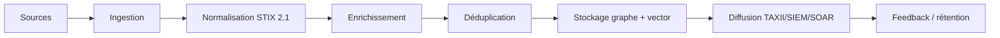

# Architecture des pipelines CTI/OSINT — synthèse (vérifié le 2026-11-10)

Contexte : radar-cyber collecte déjà ~5,6 M d'indicateurs pour 392 orgs (Nouvelle-Aquitaine) avec des collecteurs TS maison (NVD, crt.sh, quarantaine dark web, Hermes). Ce document décrit comment les équipes structurent un pipeline CTI de bout en bout, les patterns récurrents, les anti-patterns, et ce qu'on peut réutiliser.

Méthode : URLs ouvertes/vérifiées le 2026-11-10 (web_search + sources). Aucune URL inventée. Licences notées pour les outils open-source.

---

## 1. Pipeline canonique

Flux de référence (Kandi Brian, STIX 2.1 & TAXII 2.1) : ingest → normalize → enrich → deduplicate → store → distribute, avec supervision humaine uniquement sur les décisions de haut niveau.



Sources typiques : API (NVD, OTX, VirusTotal), flux RSS, TAXII collections, fichiers CSV/JSON, capteurs (Zeek, Suricata, Wazuh), dark web (quarantaine), OSINT (crt.sh, passive DNS).

---

## 2. Étapes et outils

### 2.1 Ingestion / bus d'événements

| Pattern | Outil | Licence | URL vérifiée | Usage |
|---|---|---|---|---|
| Bus événements | NATS JetStream | Apache-2.0 | https://github.com/nats-io/nats-server | At-least-once, léger, utilisé par core-graph (docs/architecture/overview.md) |
| Bus événements | Kafka | Apache-2.0 | https://kafka.apache.org | Haut volume télémétrie, utilisé par GNAT pour ingest |
| Bus événements | RabbitMQ | MPL-2.0 | https://www.rabbitmq.com | Files classiques, moins courant en CTI récent |
| Orchestration | n8n | Sustainable Use License (fair-code) | https://github.com/n8n-io/n8n | Orchestration no-code du SOC (voir lab Wazuh/OpenCTI) |
| Orchestration | Celery/APScheduler | BSD-3 / MIT | https://docs.celeryq.dev | Planification ingest GNAT |

### 2.2 Normalisation STIX 2.1

- STIX 2.1 = modèle de données (SDO : Indicator, Malware, ThreatActor, AttackPattern, Campaign, Vulnerability ; SRO : Relationship, Sighting). Source : OASIS CTI documentation (https://oasis-open.github.io/cti-documentation/stix/walkthrough.html).
- TAXII 2.1 = transport (collections + API roots, canaux conceptuels mais non pleinement spécifiés en 2.1 → s'appuyer sur collections). Source : Kandi Brian (https://kandibrian.com/articles/stix-taxii-threat-intelligence-pipelines.html).
- Validation deux niveaux (structurel + sémantique) recommandée (GNAT, https://github.com/wrhalpin/GNAT).

### 2.3 Enrichissement

| Technique | Outil/Service | Licence | URL |
|---|---|---|---|
| Passive DNS | CIRCL passive DNS | service | https://www.circl.lu/services/passive-dns/ |
| Whois/RDAP | whois/RDAP | — | https://www.iana.org/protocols/ |
| Sandbox | Cuckoo / CAPE | GPL-3.0 (CAPE) | https://github.com/kevoreilly/CAPEv2 |
| Enrichissement graph | OpenCTI connectors | Apache-2.0 | https://docs.opencti.io |
| Analyzers | Cortex | AGPL-3.0 | https://github.com/TheHive-Project/Cortex |

Note licence : Cortex est AGPL-3.0 → ne pas copier de code dans radar-cyber ; usage service OK. CAPEv2 GPL-3.0 → idem.

### 2.4 Stockage

- Graphe STIX : OpenCTI (https://github.com/OpenCTI-Platform/opencti, Apache-2.0) — stockage knowledge graph, TAXII 2.1 natif.
- IOC store : MISP (https://github.com/MISP/MISP, AGPL-3.0) — stockage d'IOC, export TAXII.
- PostgreSQL + Apache AGE + pgvector : alternative légère (core-graph, https://github.com/rmednitzer/core-graph).
- Solr full-text pour recherche (GNAT).

### 2.5 Détection

- Wazuh (GPL-2.0, https://github.com/wazuh/wazuh) : détection + corrélation, intégration OpenCTI temps réel (https://wazuh.com/blog/real-time-threat-correlation-with-wazuh-and-opencti/).
- Règles custom pour matcher IOC (ex. rule 100622 dans le lab fermé Wazuh/TheHive/Cortex/MISP/OpenCTI).

### 2.6 Diffusion

- TAXII collections (hub-spoke ou peer-to-peer).
- SIEM (Wazuh/Elastic), EDR, firewalls/DNS filters, SOAR (n8n, TheHive).
- Webhooks fan-out (GNAT).

---

## 3. Anti-patterns signalés

1. **Spaghetti d'intégrations** : scripts custom par paire d'outils (custom-misp.py, custom-opencti) → dette, pas de contrat. Source : lab SOC fermé (Medium, https://medium.com/@tatsering1010/building-a-closed-loop-soc-from-scratch-how-i-wired-wazuh-thehive-cortex-misp-and-opencti-into-a2d603070762).
2. **Bloom de doublons** : même IOC réingéré N fois sans dédup STIX par id/pattern → bruit. Mitigation : dédup par shared STIX identifiers + multi-source confidence (Kandi Brian).
3. **Sources non curées** : blocklists mondiales noyant le signal → filtrer par pertinence org (radar-cyber : 522 061 → 65 gardés).
4. **Dette de normalisation** : formats hétérogènes jamais mappés en STIX → perte de contexte. Mitigation : normaliser à l'ingest.
5. **Enrichissement synchrone bloquant** : enrichir dans le chemin critique → latence. Mitigation : bridges asynchrones (5 min cadence, idempotent state) comme l'Enrich Bridge du lab.

---

## 4. Architectures réelles comparées

### 4.1 CERT national (CIRCL / MISP foundations)
- MISP comme plateforme centrale d'IOC ; events/attributes/objects ; intégrations consomment via API. Source : https://forum.cert.br/forum2026/slides/misp2026-circl.pdf.
- Licence MISP : AGPL-3.0.

### 4.2 SOC entreprise (Wazuh + OpenCTI + MISP + Cortex + TheHive)
- Détection → MISP lookup → rule re-injection → TheHive (dédup) → Enrich Bridge (Cortex/OpenCTI) → graphe OpenCTI. Source : Medium (URL ci-dessus).
- Cadence 5 min, idempotent state, réseau isolé.

### 4.3 SOC automatisé (Wazuh + n8n + OpenCTI + MISP + Cortex + DFIR-IRIS)
- n8n orchestre : normalisation, extraction IOC, filtre privés, enrichissement OpenCTI, triage IA, payload DFIR-IRIS, notif Telegram. Source : https://github.com/rabiulhasann/wazuh-documentation (complete_soc_automation_lab_installation_and_configuration.md).
- Passive DNS et sandbox en extensions.

### 4.4 Homelab CTI (OpenCTI seul)
- OpenCTI graphe STIX 2.1 + TAXII 2.1, connectors (VirusTotal, RansomwareLive). Source : https://labs.cosmicbytez.ca/projects/2026-06-24-opencti-threat-intelligence-platform.

### 4.5 core-graph (architecture légère)
- NATS JetStream → ingest pipeline (NER + entity resolution) → PostgreSQL (AGE + pgvector) → REST API + TAXII. Source : https://github.com/rmednitzer/core-graph/blob/main/docs/architecture/overview.md.

---

## 5. Schéma d'intégration recommandé (texte)

```
[Collecteurs TS] --JSON--> [NATS JetStream topic raw.*]
   --> [Normalizer STIX] --> [topic stix.*]
   --> [Enricher async] (passive DNS, Whois, NER orgs)
   --> [Dedup MinHash LSH]
   --> [PostgreSQL (events, indicators, orgs)]
   --> [API Fastify] / [TAXII collections] / [Webhooks]
   --> [Hermes bots] (diffusion)
```

---

## À transposer dans radar-cyber

1. **Introduire un bus d'événements léger (NATS JetStream, Apache-2.0)** entre collecteurs et normalisation, pour découpler ingestion et traitement ; éviter le spaghetti d'intégrations (anti-pattern §3.1).
2. **Normaliser à l'ingest en STIX 2.1 minimal** (Indicator + Relationship + Sighting) pour dédup par id/pattern et multi-source confidence, plutôt que des schémas ad hoc par collecteur.
3. **Déplacer l'enrichissement (passive DNS, Whois, NER orgs) dans un bridge asynchrone cadencé** (ex. 5 min, idempotent state) plutôt que dans le chemin critique du collecteur — comme l'Enrich Bridge du lab SOC.
4. **Garder la dédup MinHash LSH (datasketch, MIT)** déjà prévue (voir docs/research/enrichment.md §2) et l'appliquer aux titres+summary avant insertion, pour éviter le bloom de doublons.
5. **Maintenir le filtre anti-bruit par org** (522 061 → 65) comme étape explicite du pipeline, avec métrique, pour ne pas noyer le signal par les blocklists mondiales.
6. **Documenter les licences** : éviter de copier du code AGPL/GPL (Cortex, MISP, CAPEv2, Wazuh) ; usage service/API acceptable. Privilégier Apache-2.0/MIT (OpenCTI, NATS, spaCy, trafilatura).
